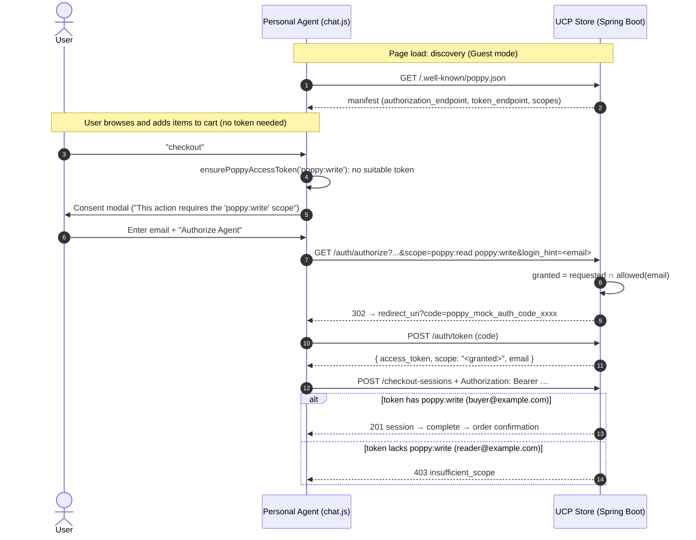

# Personal Agent Protocol (Poppy) Integration

This document explains how the **Personal Agent Protocol (Poppy)** is applied in the UCP demo store, and walks through concrete examples using two demo accounts with different permissions.

> ⚠️ **Demo scope**: the OAuth server in this project is a **mock**. There are no passwords: entering a known email counts as signing in. Tokens are opaque and kept in memory. Use it to demonstrate the protocol, not as a security model.

---

## 1. What Poppy Adds

Poppy lets a **personal agent** (an assistant acting for the end user) do three things:

1. **Discover** what a store offers by reading a well-known manifest.
2. **Get delegated authorization** from the user through an OAuth 2.0 consent step.
3. **Call protected commerce operations** (checkout, orders, payments) with a Bearer token limited to the scopes the user's account is allowed to grant.

Without Poppy, the agent can still browse the catalog anonymously ("Guest mode"). Anything that acts on the user's behalf requires a token, and what the agent may do depends on **who** signed in.

---

## 2. Demo Accounts

The scopes an agent receives depend on the email entered in the consent dialog:

| Email | Allowed scopes | Can browse | Can look up orders | Can check out |
|-------|----------------|:----------:|:------------------:|:-------------:|
| `reader@example.com` | `poppy:read` | ✅ | ✅ | ❌ `403 insufficient_scope` |
| `buyer@example.com` | `poppy:read` `poppy:write` | ✅ | ✅ | ✅ |
| any other email | none | ✅ | ❌ `access_denied` | ❌ `access_denied` |

The accounts are defined in `PoppyTokenStore.DEMO_USERS`. To add more, edit that map.

The store grants the **intersection** of the scopes the agent asks for and the scopes the account allows. The agent always asks for `poppy:read poppy:write`, so:
- `reader@example.com` gets a token with only `poppy:read`.
- `buyer@example.com` gets a token with `poppy:read poppy:write`.

---

## 3. Components

| Layer | File | Responsibility |
|-------|------|----------------|
| Manifest | `src/main/resources/static/.well-known/poppy.json` | Describes the store, its OAuth endpoints, scopes and channels |
| Discovery endpoint | `src/main/java/com/ucp/poc/controller/PoppyDiscoveryController.java` | Serves `GET /.well-known/poppy.json` |
| Account & token store | `src/main/java/com/ucp/poc/service/PoppyTokenStore.java` | Demo accounts, single-use authorization codes, access tokens and their scopes |
| Mock OAuth server | `src/main/java/com/ucp/poc/controller/MockAuthController.java` | `GET /auth/authorize` (picks scopes from `login_hint`) and `POST /auth/token` |
| Scope check | `src/main/java/com/ucp/poc/config/PoppySecurityInterceptor.java` | `401` for missing or unknown tokens, `403` when the token lacks the required scope |
| Interceptor registration | `src/main/java/com/ucp/poc/config/WebMvcConfig.java` | Lists which paths are protected |
| Consent UI | `src/main/resources/static/index.html` (`#poppy-oauth-modal`), `css/chat.css` | "Authorize Personal Agent" dialog with an email field |
| Agent client | `src/main/resources/static/js/chat.js` (`poppyConfig`, `discoverPoppyCapabilities`, `initiateOAuthLoginFlow`, `ensurePoppyAccessToken`, `poppyAuthHeaders`) | Discovery, consent, token and scope storage, header injection |

### Scopes

| Scope | Grants | Required for |
|-------|--------|--------------|
| `poppy:read` | Reading orders and payments | `GET` on protected paths |
| `poppy:write` | Creating checkouts and changing state | `POST`, `PUT`, `DELETE`, … on protected paths |

### Protected vs. public endpoints

| Endpoint | Protection |
|----------|-----------|
| `/.well-known/poppy.json`, `/.well-known/ucp`, `/.well-known/agent.json` | Public |
| `/ucp/catalog/**`, `/carts/**` | Public (Guest mode) |
| `/auth/authorize`, `/auth/token` | Public (OAuth endpoints) |
| `GET /checkout-sessions/**`, `GET /ucp/orders/**`, `GET /ucp/payments/**` | `poppy:read` |
| `POST`/`PUT`/… `/checkout-sessions/**`, `/ucp/orders/**`, `/ucp/payments/**` | `poppy:write` |

`OPTIONS` (CORS preflight) requests always pass through.

### Error responses

| Situation | Status | Body |
|-----------|--------|------|
| No token, malformed header, or unknown token | `401` | `{"error": "invalid_token", ...}` + `WWW-Authenticate: Bearer error="invalid_token"` |
| Valid token without the required scope | `403` | `{"error": "insufficient_scope", "error_description": "<email> has not granted the '<scope>' scope."}` + `WWW-Authenticate: Bearer error="insufficient_scope", scope="<scope>"` |
| Unknown email at `/auth/authorize` | `302` | redirect to `redirect_uri?error=access_denied&error_description=Unknown account: ...` |
| Reused or invalid code at `/auth/token` | `400` | `{"error": "invalid_grant", ...}` |
| Unsupported `grant_type` | `400` | `{"error": "unsupported_grant_type"}` |

---

## 4. End-to-End Flow



### Step by step

1. **Discovery (on page load).** `discoverPoppyCapabilities()` fetches the manifest and stores the authorization and token endpoints. The agent starts in **Guest mode**.
2. **Browsing.** Catalog search and cart operations work without a token.
3. **Escalation.** Before a protected action, the agent calls `ensurePoppyAccessToken(scope)`:
   - checkout → `ensurePoppyAccessToken('poppy:write')`
   - order lookup → `ensurePoppyAccessToken('poppy:read')`

   If the current token already has that scope, nothing happens. Otherwise the consent modal opens and shows which scope the action needs.
4. **Consent.** The user enters an email and clicks **Authorize Agent**. The email is sent as the standard OIDC `login_hint` parameter, and the store decides which scopes to grant. **Deny** cancels the action.
5. **Protected call.** `poppyAuthHeaders()` adds `Authorization: Bearer <token>`. The store checks the token's scopes on every request. The client never decides access on its own: if the account lacks the scope, the request is still sent and the store answers `403`.

The token is kept **in memory only**. Reloading the page drops it. If a later action needs a scope the current token lacks, the modal opens again so the user can sign in with another account.

---

## 5. Examples

All examples assume the app is running locally on `http://localhost:8080` (`mvn spring-boot:run`). Tokens and codes are random; replace the placeholders with the values you get.

### 5.1 Discover the store

```bash
curl -s http://localhost:8080/.well-known/poppy.json
```

```json
{
  "$schema": "https://personalagentprotocol.org",
  "protocol_version": "0.1",
  "authentication": {
    "authorization_endpoint": "http://localhost:8080/auth/authorize",
    "token_endpoint": "http://localhost:8080/auth/token",
    "supported_grant_types": ["authorization_code"],
    "scopes": [
      { "name": "poppy:read",  "description": "..." },
      { "name": "poppy:write", "description": "..." }
    ]
  },
  "channels": { "openapi": [ ... ], "company_agent": { ... } }
}
```

### 5.2 Call a protected endpoint without a token

```bash
curl -i -X POST http://localhost:8080/checkout-sessions -H 'Content-Type: application/json' -d '{}'
```

```http
HTTP/1.1 401
WWW-Authenticate: Bearer error="invalid_token"

{"error": "invalid_token", "error_description": "Poppy access token is not valid."}
```

---

### 5.3 Example A: `reader@example.com` (read only)

**Step 1: authorize.** The agent asks for both scopes:

```bash
curl -i 'http://localhost:8080/auth/authorize?response_type=code&client_id=personal-agent-frontend&redirect_uri=http://localhost:8080&scope=poppy:read%20poppy:write&state=xyz123&login_hint=reader@example.com'
```

```http
HTTP/1.1 302
Location: http://localhost:8080?state=xyz123&code=poppy_mock_auth_code_1a2b3c4d
```

**Step 2: exchange the code.** Only `poppy:read` is granted:

```bash
curl -s -X POST http://localhost:8080/auth/token \
  -d grant_type=authorization_code \
  -d code=poppy_mock_auth_code_1a2b3c4d
```

```json
{
  "access_token": "poppy_mock_access_token_aaaa…",
  "token_type": "Bearer",
  "expires_in": 3600,
  "refresh_token": "poppy_mock_refresh_token_…",
  "scope": "poppy:read",
  "email": "reader@example.com"
}
```

**Step 3: read an order. Allowed:**

```bash
READER_TOKEN=poppy_mock_access_token_aaaa…
curl -s http://localhost:8080/ucp/orders/<order-id> -H "Authorization: Bearer $READER_TOKEN"
```

```http
HTTP/1.1 200
{ "id": "<order-id>", ... }
```

**Step 4: try to check out. Rejected:**

```bash
curl -i -X POST http://localhost:8080/checkout-sessions \
  -H 'Content-Type: application/json' \
  -H "Authorization: Bearer $READER_TOKEN" \
  -d '{ "line_items": [{ "item": { "id": "<product-id>" }, "quantity": 1 }] }'
```

```http
HTTP/1.1 403
WWW-Authenticate: Bearer error="insufficient_scope", scope="poppy:write"

{"error": "insufficient_scope", "error_description": "reader@example.com has not granted the 'poppy:write' scope."}
```

**In the chat UI:** typing **checkout** opens the modal ("This action requires the 'poppy:write' scope"). After signing in as `reader@example.com`, the chat shows:

> ❌ Payment Failed: reader@example.com has not granted the 'poppy:write' scope.

No checkout session is created. Order lookups work with this token without asking again.

---

### 5.4 Example B: `buyer@example.com` (read + write)

**Step 1: authorize:**

```bash
curl -i 'http://localhost:8080/auth/authorize?response_type=code&client_id=personal-agent-frontend&redirect_uri=http://localhost:8080&scope=poppy:read%20poppy:write&state=xyz123&login_hint=buyer@example.com'
```

```http
HTTP/1.1 302
Location: http://localhost:8080?state=xyz123&code=poppy_mock_auth_code_5e6f7a8b
```

**Step 2: exchange the code.** Both scopes are granted:

```bash
curl -s -X POST http://localhost:8080/auth/token \
  -d grant_type=authorization_code \
  -d code=poppy_mock_auth_code_5e6f7a8b
```

```json
{
  "access_token": "poppy_mock_access_token_bbbb…",
  "token_type": "Bearer",
  "expires_in": 3600,
  "refresh_token": "poppy_mock_refresh_token_…",
  "scope": "poppy:read poppy:write",
  "email": "buyer@example.com"
}
```

**Step 3: check out. Allowed:**

```bash
BUYER_TOKEN=poppy_mock_access_token_bbbb…

# Create the checkout session
curl -s -X POST http://localhost:8080/checkout-sessions \
  -H 'Content-Type: application/json' \
  -H 'UCP-Agent: my-personal-agent/1.0' \
  -H "Authorization: Bearer $BUYER_TOKEN" \
  -d '{
        "line_items": [{ "item": { "id": "<product-id>" }, "quantity": 1 }],
        "buyer":   { "first_name": "Jane", "last_name": "Doe", "email": "buyer@example.com" },
        "context": { "currency": "USD", "language": "en", "address_country": "US" }
      }'

# Complete it (see checkoutViaREST in chat.js for the full payment payload)
curl -s -X POST http://localhost:8080/checkout-sessions/<session-id>/complete \
  -H 'Content-Type: application/json' \
  -H "Authorization: Bearer $BUYER_TOKEN" \
  -d '{ ... }'
```

**Step 4: read the resulting order. Allowed:**

```bash
curl -s http://localhost:8080/ucp/orders/<order-id> -H "Authorization: Bearer $BUYER_TOKEN"
```

**In the chat UI:** typing **checkout** opens the modal. After signing in as `buyer@example.com`, checkout proceeds and the order confirmation is shown. The console logs:

```
Poppy Agent: buyer@example.com granted scopes [poppy:read, poppy:write].
```

Later checkouts in the same page session reuse the token without asking again.

---

### 5.5 Other cases

**Unknown account:**

```bash
curl -i 'http://localhost:8080/auth/authorize?response_type=code&client_id=personal-agent-frontend&redirect_uri=http://localhost:8080&scope=poppy:read&login_hint=someone@example.com'
```

```http
HTTP/1.1 302
Location: http://localhost:8080?error=access_denied&error_description=Unknown%20account:%20someone@example.com
```

In the UI: *"❌ Checkout cancelled: Unknown account: someone@example.com"*.

**Reusing an authorization code** (codes are single use):

```json
{ "error": "invalid_grant", "error_description": "Authorization code is invalid or has already been used." }
```

**Switching accounts in the UI:** sign in as `reader@example.com`, look up an order (works), then type **checkout**. The token lacks `poppy:write`, so the modal opens again. Sign in as `buyer@example.com` and the checkout goes through.

---

## 6. Known Limitations

- **Mock authorization server**: no passwords (an email alone counts as sign-in) and no real consent screen on the server side. Tokens are opaque and stored in memory: they are lost when the server restarts and never expire, even though `expires_in` says 3600. The refresh token is never used.
- **Coarse scope mapping**: the required scope comes from the HTTP method (`GET` → read, anything else → write), not from each endpoint.
- **Hardcoded URLs**: `poppy.json` uses `http://localhost:8080`, and `logo_url` points to `/images/logo.png`, which doesn't exist yet.
- **Client token storage**: in memory only, so it's lost on page reload.
- **No automated tests** for the Poppy endpoints or the scope check yet.

---

## 7. Moving Toward Production

- Replace `MockAuthController` and `PoppyTokenStore` with a real authorization server (e.g. Spring Authorization Server, Keycloak, Auth0) that authenticates users and issues signed JWTs with a `scope` claim.
- Validate tokens with Spring Security's resource-server support, and declare scopes per endpoint (e.g. `hasAuthority('SCOPE_poppy:write')`).
- Use PKCE and a real browser redirect (not a `fetch`-followed redirect) for browser-based agents.
- Generate `poppy.json` from configuration so URLs match the environment where it's deployed.
